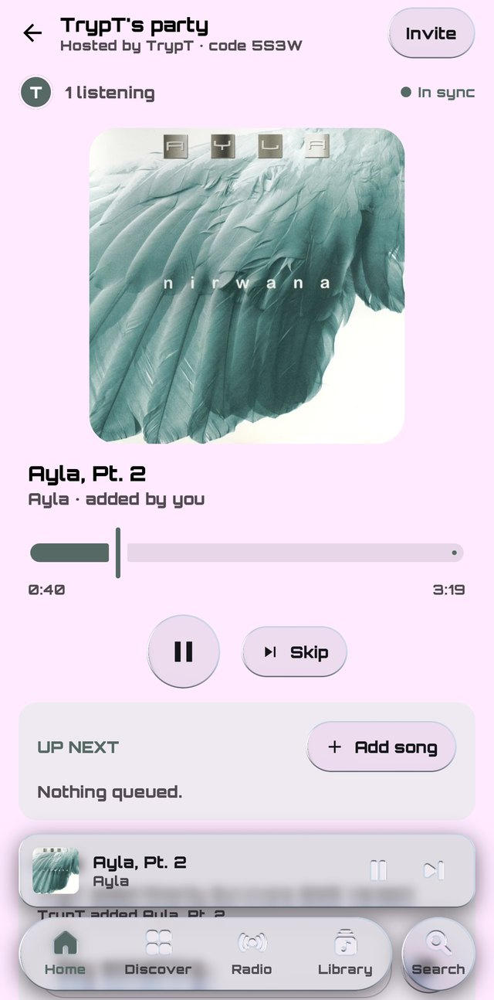
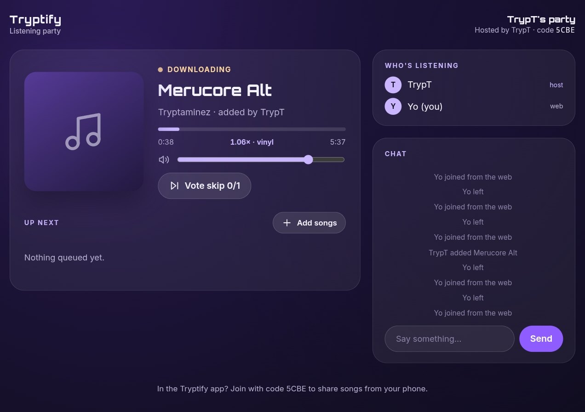
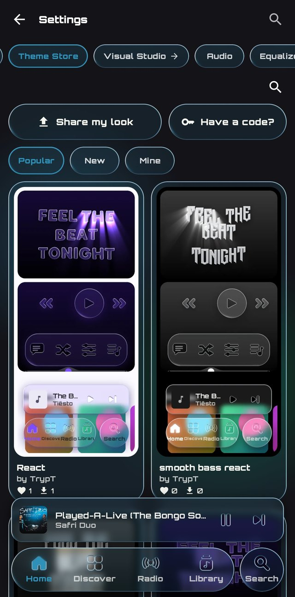
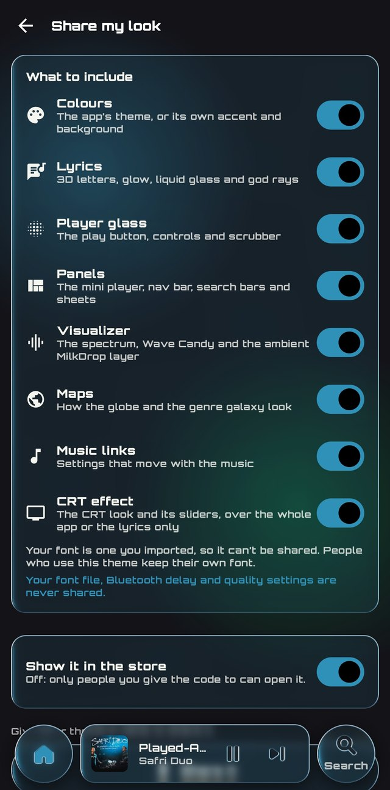
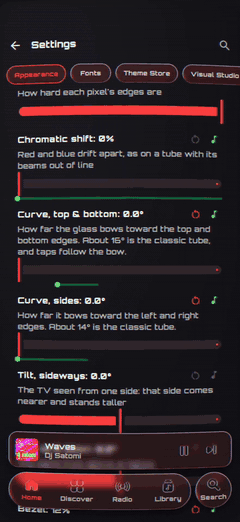
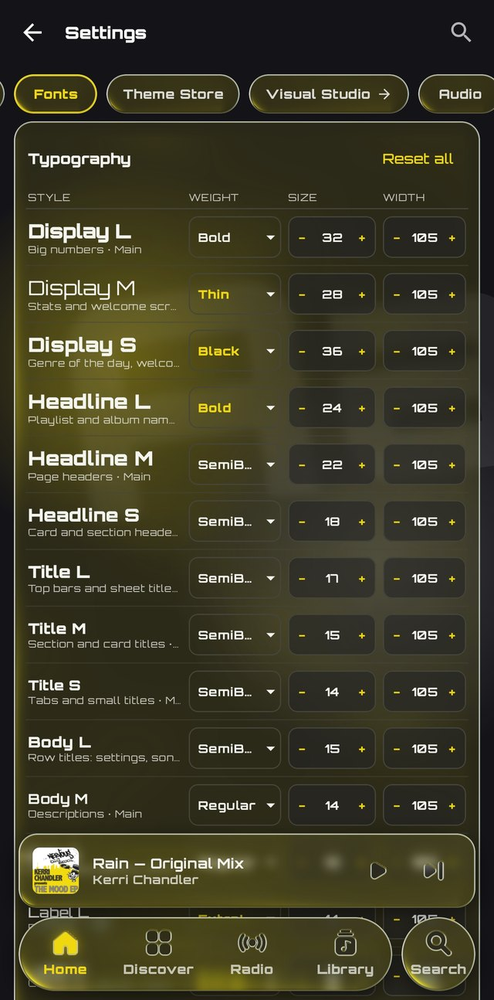

# Tryptify 1.9.4

**Trypt Mania**, a rhythm game on your own music, with multiplayer rooms. **Listening parties**, in the app or a web browser. **Your own music server** and **Tryptify Cloud**. **Bluetooth sync** for the whole app. Music links, the Theme Store, the CRT effect, a typography table, your library as a galaxy, and Italian.

Each line is marked New, Changed, Removed or Fixed. Every detail is in the [CHANGELOG](../../CHANGELOG.md).

## Trypt Mania (Beta)

<table>
  <tr>
    <td></td>
    <td></td>
  </tr>
</table>

- New: **A StepMania-style game** in Library › Local, played on your own songs.
- New: **Charts made for you** on the built-in chart server, in five difficulties; Slow (CPU) or Fast (GPU).
- New: **StepMania packs** from StepMania Online, a ZIP or a folder. Your own charts save as a pack.
- New: **The music wheel and song card**, with previews from each song's drop.
- New: **StepMania's rules**: dance points, grades AAAA to F, Judge and fail types, plus player options before every song.
- New: **Points that grow with your combo**, as in osu!: the 26th step of a combo is worth twice the first.
- New: **Retro glass noteskins, god rays on every hit**, and TV shaders over the play.
- New: **Played over your player's background**, in the colour of the song you pick.
- New: **Results, high scores and a leaderboard**, with a timing curve and Centre my timing.
- New: **Training Ground and a map editor.**
- New: **Keyboard play and Tap to sync.**
- New: **Multiplayer rooms** on your account, with a live scoreboard, and the host can send the song to anyone missing it.
- New: **Landscape**, with a lane width you set.

## Listening parties

<table>
  <tr>
    <td></td>
    <td></td>
  </tr>
</table>

- New: **Listen together, in sync.** Start a party from your profile and send its code or invite link; everyone hears the same moment of the same song.
- New: **Guests in the app or a web browser.** An invite link opens in the app; anyone without it joins from the web.
- New: **A shared Up next**, with Add to party from any song menu, many songs at once, and **vote skip**.
- New: **Chat**, in a panel under Up next.
- New: **Your phone's songs, shared.** Files and downloads you add are streamed to guests without them while they're queued. Nobody keeps them.
- New: **The host's speed for everyone**, vinyl style or not, and a listener plays the host's exact Qobuz or Deezer song.
- New: **Host controls**: hand the host's seat on, take someone out, or end the party for everyone.
- New: **Stays connected in the background**, with a round button back to the party over Search.

## Bluetooth sync

- New: **One delay per device**, in Settings › Audio › Bluetooth sync. Measure it with Trypt Mania's tap test, or nudge it 5 ms at a time.
- New: **The whole app waits for it**: lyrics, music-linked visuals, the visualizer and Trypt Mania.
- Removed: **The separate lyrics and visualizer delay sliders.** Your value carried over.

## Equalizer

- Changed: **Precision AutoEQ** has target pills and a filter editor under its graph: swipe glass pills for frequency, gain and Q.
- New: **Export to Nothing Ear** as a QR code for Nothing X.
- Fixed: **The preamp** now turns bass and treble down too.

## Music links

- New: **Effects that move with the music.** Player Visuals Studio sliders follow the kick, vocals, snare, hi-hats or a range you pick.
- New: **Mixer knobs that move with the music**, saved with the mix.
- New: **One page lists every link**, with pause, change and remove.

## Theme Store

<table>
  <tr>
    <td></td>
    <td></td>
  </tr>
</table>

- New: **Share your look** as one theme, in the store or by code. Nothing personal goes with it.
- New: **Choose what goes in it**: colours, lyrics, player glass, panels, the visualizer, maps, music links and the CRT effect, one switch each. Your font file, Bluetooth delay and quality settings are never shared.
- New: **Try someone else's**, live on the player first, part by part, with one-tap undo.

## CRT effect

<video src="1.9.4/crt-music-links.mp4" width="280" autoplay loop muted playsinline controls>
  
</video>

- New: **The whole app, or only the lyrics, through an old TV**: Scanlines, CRT, CRT-Royale and more. Android 13+.
- New: **Curve, tilt, zoom, bezel and glare** over any look; taps still land where you see.
- New: **Presets** to save, export and import. Themes can carry the effect too.
- New: **Moves with the music**: chromatic shift, curve and tilt can follow the beat, and taps still land where you see them.
- New: **Lyrics on a curved tube.**

## Look

- Removed: **The old frosted glass on lists.** Lists are plain Material 3 surfaces.
- Changed: **Lighter titles** over their descriptions.
- Removed: **The Now Playing group in Settings**, which repeated other settings.
- Fixed: **No grey band** when the mini player folds into the nav bar.

## Fonts

- New: **A typography table**: fifteen text styles, each with its own font, weight, size, width and spacing.
- New: **Letter width** from 70% to 130%.
- New: **Orbitron** is built in.
- Changed: **A condensed Fonts page.** It no longer freezes with many fonts.
- Fixed: **Imported fonts in all their weights.**

## Library

<table>
  <tr>
    <td></td>
    <td></td>
  </tr>
</table>

- New: **Open songs from other apps** with Tryptify. Add to library keeps one in Music/Tryptify.
- New: **Your library as a galaxy**: artists as stars, albums as planets, tracks as moons, drawn from their sound. Works offline.
- New: **Hold a song to hear it**, up to 25 seconds from its drop.
- Changed: **Select is in the song menu**, since holding now previews.
- Changed: **Short tracks** (intros, interludes) are in your albums.
- New: **Search and sort Downloads.**
- New: **Choose a song row's badges.**
- New: **Import a Spotify playlist from its link**, or with Exportify inside the app.
- New: **Track info**: format, rate, depth and every tag.
- Fixed: **Recently played keeps your local songs.**
- Fixed: **Track info for MP4 files.**

## Your own music server

- New: **Play your library from Navidrome, Gonic, Airsonic-Advanced, Ampache** or any Subsonic-compatible server, under Settings › Connections › Music server.
- New: **My server**, a Library page next to Local: albums, artists and Shuffle all. Its songs are in Search too.
- New: **Home addresses just work**: type `192.168.1.20:4533` and Tryptify uses http.
- New: **Your password isn't stored**, only a sign-in token, and neither leaves the phone.
- New: **How to set up**, in the same place.

## Tryptify Cloud

- New: **Your music, stored for you and played anywhere.** Upload from a song's menu; your library plays in Library › My server, like your own server.
- New: **Files kept as you upload them.** FLAC, ALAC and WAV stay lossless.
- New: **Plans from 100 GB**, with a 7-day free trial, in Settings › Connections › Tryptify Cloud. See [tryptify.com/cloud](https://tryptify.com/cloud).
- New: **Manage or cancel your subscription** from the app, and your library and devices at [tryptify.com/account](https://tryptify.com/account).

## Discover

- New: **Search the galaxy** for a genre or an artist.
- New: **One sky, two galaxies**: your library sits in the genre galaxy's sky.
- Changed: **Galaxy and Timeline are two pills.**
- Changed: **A stronger zoom.**

## Now playing

- Changed: **Long titles slide** to show in full.
- Changed: **Glass Visualizer and Waveform buttons**, and a glass speed pill.
- Changed: **The cover holds still** on kicks.
- Changed: **A glass pill picks the speed unit.**
- Fixed: **BPM at the right tempo**, up past 200.
- Fixed: **The visualizer no longer flashes** with vsync off.
- Fixed: **Glass corners** on the audio tools sheet.
- Fixed: **Panels read in light themes.**

## Lyrics

- New: **Lyrics timed by ear** on the server, word by word.
- New: **Time lyrics on the server** from the player's ⋮.
- New: **A lyrics editor** with Stamp now.
- New: **Word-timed .lrc** beside your downloads.
- Fixed: **Lyrics for songs named by number, for compilations, and for your own files.**

## Playback

- Fixed: **Seeking in Apple's ALAC files.**
- Changed: **Blends need gapless**, and **no blends in exclusive mode.**

## Exclusive USB DAC

- Changed: **More DACs**, Apple's USB-C adapter among them, at 48 kHz 24-bit.
- Changed: **DACs at their full output**, so the app's volume is the only one.
- Changed: **One volume bar**, on every screen.
- Changed: **The DAC card shows the DAC's release.**
- Fixed: **DACs that refused every song.**
- Fixed: **No full-volume burst between songs.**
- Removed: **USB DAC bit-perfect routing.** Exclusive USB DAC is the one switch.

## Account and stats

- New: **Sign in with Discord**, beside Google and email, in the app and at tryptify.com.
- New: **Your own picture and name.**
- New: **Listening stats, rebuilt**, with more charts under Dig deeper.
- New: **Trypt Mania in your stats**: songs played, best grade, full combos and accuracy.
- New: **Achievements**: goals for your listening and for Trypt Mania, kept on your phone.
- Fixed: **Golden Ears and the Quality card agree** on what Hi-Res is.
- Fixed: **Night is 9 pm to 5 am** everywhere in your stats.

## Languages

- New: **Italian**, in Settings › Appearance › Language. Tryptify now speaks eight languages.

## Settings

- Changed: **The Theme Store is a Settings tab**, right after Fonts.
- Changed: **APIs in two groups**: Streaming, and Trypt Mania's chart and rooms servers.
- Changed: **Player Visuals Studio's tabs are glass pills.**
- Changed: **The CRT effect and the glow behind album art can move with the music** from Settings › Appearance too.
